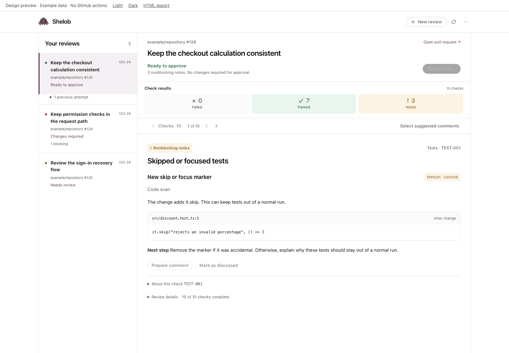
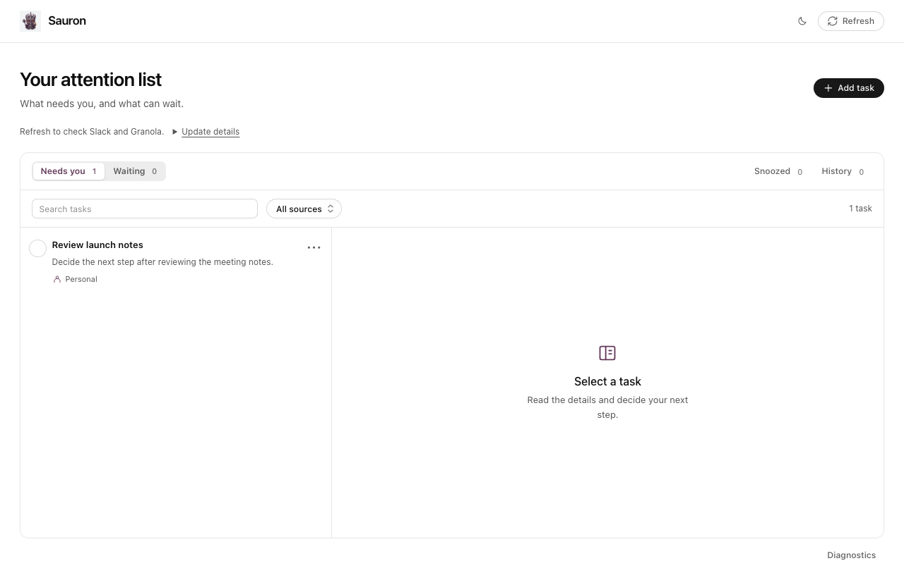
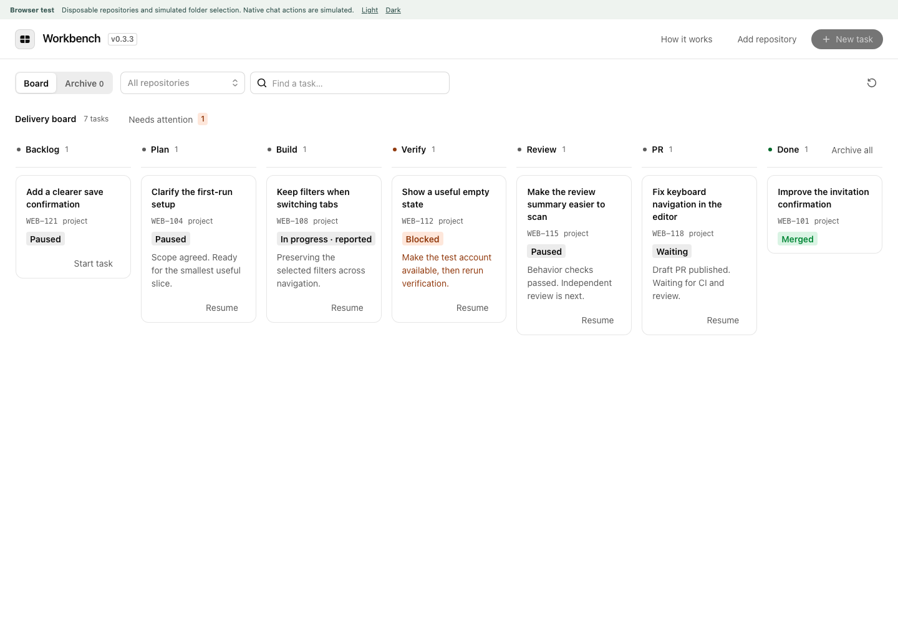

# AI Tools

Shelob, Sauron, and Workbench are local Codex plugins for code reviews, source-backed tasks, and delivery workflows. Install the products you need from one Git marketplace. Each installation uses your own accounts and local data.

| Plugin | Use it for |
| --- | --- |
| [Shelob](plugins/shelob/README.md) | Review local changes or a GitHub PR; inspect findings, rules, and saved reports. |
| [Sauron](plugins/sauron/README.md) | Organize personal and source-backed tasks, decisions, and reviewed Slack replies. |
| [Workbench](plugins/workbench/README.md) | Start or resume native Codex chats and follow a task through 13 explicit workflow commands. |

## Install

Initial target: **macOS with Codex desktop**, Node.js 22.13 or newer, and Git. GitHub features also need your own authenticated GitHub CLI. See [supported systems](docs/supported-systems.md) for feature-specific requirements and verification limits.

```sh
codex plugin marketplace add fadamakis/ai-tools --ref releases
codex plugin add shelob@ai-tools
codex plugin add sauron@ai-tools
codex plugin add workbench@ai-tools
```

Choose any subset. Open a new chat and the product's sidebar panel after installation. Release packages include runtime libraries; you do not need to build the source. Connect external apps only for features you use. Follow [getting started](docs/getting-started.md) for first-use examples.

<details>
<summary>Preview screenshots with synthetic data</summary>







Browser previews use disposable examples; native-host checks are recorded separately.
</details>

## Updates and data

```sh
codex plugin marketplace upgrade ai-tools
codex plugin add shelob@ai-tools
```

Repeat the install command for the other products you use. Reopen their panels and check the loaded versions; restart the desktop app if a previous process remains active. See [updates and recovery](docs/updates.md) for the full procedure and its activation checks.

State stays outside versioned caches. Installation does not create schedules, scan sources, send messages, push code, or approve PRs. Model and connected-service requests can send selected content to their providers; read [privacy and permissions](docs/privacy-and-permissions.md).

## Help and development

- [Troubleshooting](docs/troubleshooting.md) and [data compatibility](docs/compatibility.md)
- [Contributing and local verification](CONTRIBUTING.md)
- [Release procedure](docs/rollout.md) and [optional workspace import](docs/workspace-setup.md)
- [Prepare verified release downloads](docs/rollout.md#prepare-an-existing-release)
- [Security reports](SECURITY.md) and [changes](CHANGELOG.md)

Source is maintained on `main`; validated packages are published to `releases`. Independent installations use that release channel. Official directory publication is a separate process.

## License

MIT, copyright 2026 Fotis Adamakis. See [LICENSE](LICENSE). Each plugin package includes its project license and bundled third-party notices.
