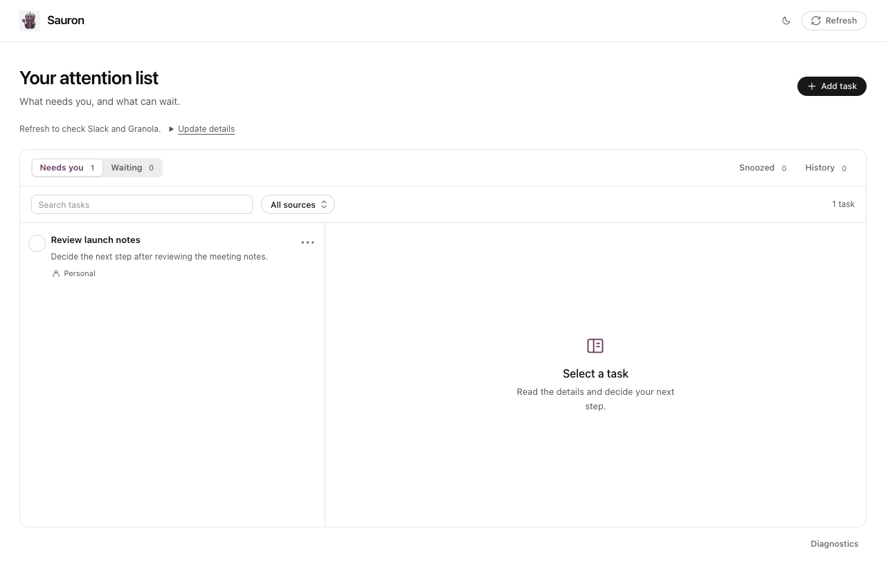

# Sauron

## Input sources

Open the Refresh dropdown to toggle Slack, Jira, GitHub, Calendar or Meetings
(Granola). Each choice saves immediately and applies to manual and automatic
pulls. Existing tasks remain visible and editable; use the separate source filter
to narrow the task list. Personal tasks and explicit actions on saved tasks remain
available.

Refresh now checks enabled Slack and Meetings sources only. Automatic and
chat-led updates check all enabled providers. Source settings are locked while
an update or pending reconciliation is active. Turning everything off pauses
source work without changing schedules or update ownership. Re-enabling a source
resumes from its saved checkpoint on the next update.

Preferences use additive local-store metadata. Existing databases default to all
sources enabled; no task migration is required. Updated workers and chat-led sync
instructions must be used together to respect disabled sources before connector
access. Older callers that submit disabled-source observations are rejected.


Discussions opened from an item ask the new chat to save its link back to that item. Saved links survive source updates and app restarts; **Continue discussion** reopens the saved conversation. Hosts without current-chat identity support can use **Link a chat** with a copied ChatGPT or Codex conversation URL. Linking never changes the task's decision or source identity.

Keep source-backed Slack, Jira, GitHub, Calendar, and meeting actions together with personal tasks, saved decisions, and reviewed Slack replies.

Sauron now separates new work from committed work. New source obligations and proposed Codex follow-ups enter Inbox for review. Accepted tasks move to Ready, In progress, or Waiting. Today shows up to three user-chosen focus tasks above the ordered actionable list, with BLEX, PEX, personal, and unassigned filters. Real due dates and dates to review waiting work are separate. Source checks can update evidence without replacing your task plan or order.

Use the daily summary to review Inbox and choose focus work. Weekly review links to Inbox, Waiting, and Today. Sauron suggests focus when an explicit due date is today or past due; it never reorders the list automatically.

To track selected Codex chats, first ask Codex to list and categorize chats started in the last 24 hours. Then select the ones you want with `@Sauron track threads X, Y, and Z`. Sauron creates one personal task per selected chat, saves a link back to it, and reuses that task if you track the same chat again. The listing step does not create tasks. Codex needs access to its chat listing and reading tools to verify the selections.

For several follow-ups from one selected chat, ask Codex to propose those actions in Sauron. `propose_codex_followups` links each distinct proposal to the verified chat and leaves every proposal in Inbox. Repeating the same chat ID and action key reuses the existing proposal, including any review decision.

## Use

Install Sauron from the workspace plugin directory and open its Codex sidebar. The initial team release supports macOS with Node 22.13 or newer. The UI and MCP server dependencies are bundled; no source checkout or npm installation is needed.

Refresh reads Slack and Granola through the signed-in user's existing Codex connections. Dot-fed sync can add source-backed observations to the same local store. Installing Sauron does not configure schedules, start source checks, or connect someone else's accounts. Task decisions survive refreshes, replay, and restarts.

Reply preparation creates a local editable draft. Only the explicit **Send to Slack** action authorizes sending the reviewed text to its verified original thread. Uncertain delivery retains the draft and cannot automatically resend. Tests simulate these actions and must not send real messages.

## Saved data and upgrades

The default macOS database is `~/Library/Application Support/Sauron/attention.sqlite`. An explicit `ATTENTION_DB` path takes precedence. Database schema 3, store identity, tasks, decisions, history, receipts, and reply drafts remain readable. Data is outside versioned plugin caches. Unknown newer schemas are rejected.

The productivity update keeps SQLite schema 3. On first open, Sauron saves planning metadata for existing tasks: Needs you becomes Ready, Waiting stays Waiting, and completed or dismissed decisions remain authoritative. Task rows, source identities, receipts, and history are not rewritten by this mapping. Earlier plugin builds ignore the planning metadata; reinstalling the new build restores the accepted plan and order. New source observations and proposed chat follow-ups enter Inbox after the update.

Existing personal installations that need to move their selected database must stop Sauron and its scheduled writers before migrating it:

```sh
node scripts/migrate-data.mjs --from /absolute/path/to/existing.sqlite --confirm-writers-stopped
```

Run that command from an extracted plugin package. In the source repository, use `pnpm sauron:migrate` with the same arguments. The command makes and verifies a consistent SQLite backup, retains the original, and refuses an existing destination. It never merges databases, checks external sources, or sends replies.

After verifying the new installation, update existing local schedules to `node /absolute/path/to/plugin/dist/server/check-attention.js`, preserving their cadence and intent. `--manual-scan` explicitly requests a source scan; omitting it honors coordination mode. `dist/server/sync-attention.js` accepts the existing JSON sync requests on stdin. Both use the same durable database.

Reopen the panel after an update; restart Codex if it still shows the old build. A data refresh does not reload installed application code.

## Maintain

Use the root repository's pnpm workspace, lockfile, build, and verification commands. Existing tool names, UI resource aliases, operation IDs, and `ATTENTION_DB` remain supported. The standalone personal adapter helper remains an authoring/testing utility and is not the distributable team package.

For an isolated fixture-based native Codex workflow from this checkout, see [Sauron Dev](docs/development.md).

## Local automatic updates candidate

The unreleased local-managed implementation, verification boundary and safe writer cutover are documented in [Local updates](docs/local-updates.md). The current headless CLI cannot execute all five connected sources; local ownership remains guarded and must not be enabled until that runtime check succeeds. No schedule is installed automatically.

## Preview

Synthetic data in the browser preview; this image does not establish native-host acceptance.


